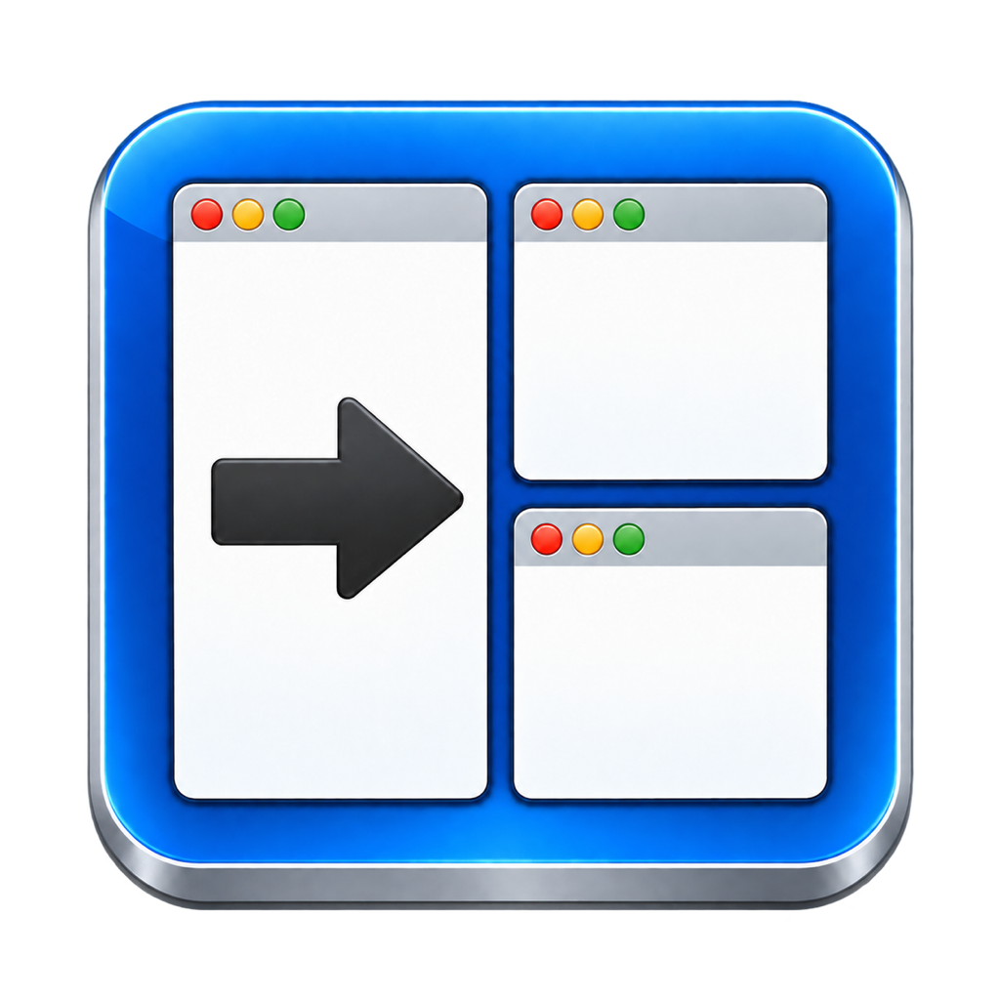

  

# Optimal Layout redux

A lightweight modern-macOS-compliant take on [Optimal Layout 🪦2015🥀](https://optimal-layout.macupdate.com/), an app for controlling window sizes and position on screen.
Arrange the focused window with keyboard shortcuts or menu commands.
Requires macOS 14+ on Apple Silicon or Intel.

**[Download the latest release](https://github.com/sbone/simple-window-manager/releases/latest)**
 · [Report a bug](https://github.com/sbone/simple-window-manager/issues/new?template=bug_report.md)
 · [Browse feedback](https://github.com/sbone/simple-window-manager/issues)

## Install

Download the DMG from [GitHub Releases](https://github.com/sbone/simple-window-manager/releases/latest)
and drag **Optimal Layout** into **Applications**. Eject the
DMG, then open the app from Applications and grant Accessibility access when
prompted. Look for the **window-grid icon** in the menu bar; there is no Dock icon or main window.
No Xcode or command-line tools are needed to use a release.

Open **Settings…** from the menu to see Accessibility permission, launch-at-login
status, update preferences, shortcut conflicts, and the last window-command error.
Status refreshes when you return from System Settings; **Refresh Status** checks
again. **Copy Diagnostics** collects version, app location, statuses, and errors
for a bug report. Screen Recording and Input Monitoring are not required.

Quit other copies of Optimal Layout before testing. Keep a backup if replacing
the original app. Development builds using the old `local.OptimalLayout`
identifier need a fresh Accessibility grant for this release. Disable Launch at
Login in the old copy before enabling it in the installed copy.

For updates, choose **Check for Updates…** from the menu. Builds before 0.2.0
need one manual replacement in Applications while OL is closed. To uninstall,
disable Launch at Login, quit, and move it to Trash.
See the [included quick start](Resources/Install.txt).

## Feedback

[Report a bug](https://github.com/sbone/simple-window-manager/issues/new?template=bug_report.md)
with the app version/build, macOS version, affected app, shortcut or menu command,
display arrangement, and expected versus actual behavior. **Settings → Copy
Diagnostics** supplies version and status details. Review it before posting:
the app's local path may contain your username or other personal folder names.

## Window controls

Focus a normal resizable window, then use a shortcut or its menu command:

| Shortcut | Action |
| --- | --- |
| ⌘⌥1 | Fill the display's usable area |
| ⌘⌥2 | Cycle left half → right half |
| ⌘⌥3 | Centered, full-height half-width window |
| ⌘⌥4 | Cycle upper-left → upper-right → lower-right → lower-left |
| ⌘⌥0 | Move to the next display |

Cycles are shared across windows and reset on restart. Display switching
preserves window size and relative position. Quit the legacy Optimal Layout
or other apps using these shortcuts to avoid conflicts.

Failed commands beep and change the menu-bar icon to a **warning triangle**. Open **Window Command
Failed…** for the reason and recovery advice, also shown in the tooltip.
Partial moves are reported; failed layouts do not advance the cycle. A successful
command clears the window error.

**Shortcut Problems…** identifies registration failures. Other shortcuts and
menu commands remain available. Resolve the conflict and restart OL to retry.
Conflict detection covers errors reported by Carbon, not every third-party
shortcut interception mechanism.

## Launch at Login

Choose **Launch at Login** from the menu to toggle startup for your account. A checkmark
means enabled; a dash means approval is required. Use **Approve Launch at Login…**
to open System Settings, or click the pending toggle to cancel registration.
Keep the app at a stable path; rebuilding in place preserves it.

## Accessibility troubleshooting

Keep the same signing identity and bundle identifier to preserve access. Switching
from ad-hoc to certificate signing may require a fresh grant. If commands stop
working after a rebuild:

1. Quit OL.
2. Remove **Optimal Layout** from System Settings → Privacy & Security → Accessibility.
3. Use **+** to add the rebuilt `Optimal Layout.app` and enable it.
4. Reopen the app.

## Current scope

Four built-in layouts, focused-window commands, and a native Settings window.
Custom layouts and per-application rules are not implemented. Full-screen windows,
apps with minimum window sizes, and additional display arrangements need validation. The app
checks API results but does not read frames back, so an app can report success
while constraining the requested size. See the [verification record](DEVELOPMENT.md#verification-record) for outstanding
release checks.

## Design choices

The app keeps common window arrangements a keystroke away. Four fixed layouts
cover filling the usable screen, working side by side, centering a narrower
window, and arranging quarters. Cycling halves and corners keeps the shortcut
set small; cycles are shared across windows. Custom layouts and per-app rules
would add configuration beyond this focused scope.

AppKit owns the menu-bar app and SwiftUI presents Settings. Accessibility APIs
move the focused window; Carbon registers global shortcuts without requiring
Input Monitoring. Menu commands use the same window-control path, so they remain
available when a shortcut cannot be registered.

Geometry is separate from macOS calls, and the Accessibility boundary is
injectable. This lets unit tests check display coordinates, layout cycles, and
API failures without moving real windows. A separate GUI harness exercises
the installed behavior on a logged-in desktop.

Distribution uses Developer ID signing, notarized universal DMGs, and Sparkle
with signed update metadata. Publishing builds fresh artifacts from the exact
source commit. These checks do not prove every installation or upgrade journey:
the [verification record](DEVELOPMENT.md#verification-record) distinguishes
completed checks from pending fresh-Mac, Intel, and real-update testing.

## App icon

The icon is an homage to the original Optimal Layout app's icon, carrying forward
its window-and-arrow motif in a blue, dimensional design.

## Development

See [DEVELOPMENT.md](DEVELOPMENT.md) for building, testing, signing, publishing,
and icon assets.

- [Legacy-app findings](optimal-layout-reverse-engineering.md)
- [Archived investigation and handoff](docs/archive/optimal-layout-reverse-engineering-handoff.md)
